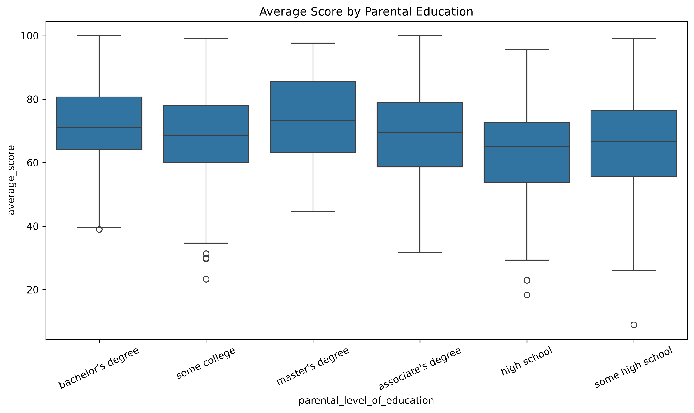

# Student Performance Analysis & Score Prediction

Exploratory data analysis (EDA) and a simple machine learning model on student exam results, to understand which factors are linked to higher or lower scores and to predict a student's **math score**.

## Overview

A school wants to know what is associated with student academic performance. This project cleans a dataset of 1,000 students, engineers a few features, explores the patterns with visualisations, and trains a Linear Regression model to predict math scores from the other available information.

## Dataset

`data/StudentsPerformance.csv` contains **1,000 students** and **8 columns**:

| Column | Description |
|---|---|
| `gender` | Student's gender |
| `race/ethnicity` | Group A to E |
| `parental level of education` | Highest education level of the parents |
| `lunch` | Standard or free/reduced |
| `test preparation course` | Completed or none |
| `math score`, `reading score`, `writing score` | Exam scores out of 100 |

`data/students_cleaned.csv` is the cleaned output of the notebook, with these added columns: `average_score`, `total_score` and `performance` (Excellent ≥ 90, Good ≥ 75, Average ≥ 60, otherwise Poor).

## Workflow

1. **Data understanding:** inspect shape, types and summary statistics.
2. **Data cleaning:** no missing values or duplicates found; column names standardised to snake_case.
3. **Feature engineering:** average score, total score and performance category.
4. **EDA:** score distributions, box plots, correlation heatmap and pair plot.
5. **Machine learning:** one-hot encoding, 80/20 train-test split, Linear Regression, evaluated with MAE, MSE, RMSE and R².

## Key findings

- **Reading has the highest average score (69.17), math the lowest (66.09).**
- **Test preparation helps:** students who completed the course average 72.67, against 65.04 for those who didn't.
- **Lunch type matters:** standard-lunch students average 70.84, against 62.20 for free/reduced lunch.
- **Parental education:** higher levels of parental education are generally associated with better scores.
- **Gender** shows little effect on math scores.
- **Reading and writing scores are very strongly correlated**, and math is also strongly related to both.
- **Performance categories:** Average is the largest group (391 students), then Poor (285), Good (272) and Excellent (52).



## Machine learning

A Linear Regression model predicts `math_score` from gender, race/ethnicity, parental education, lunch, test preparation and the reading and writing scores. Columns derived from the target (`average_score`, `total_score`, `performance`) are excluded to avoid data leakage. Run the notebook to see the model's metrics and feature coefficients.

## Repository structure

```
├── notebooks/
│   └── Student_Performance_Analysis.ipynb
├── data/
│   ├── StudentsPerformance.csv
│   └── students_cleaned.csv
├── images/
│   └── parental_education_boxplot.png
├── requirements.txt
└── README.md
```

## Getting started

```bash
git clone https://github.com/hridesh646-dev/Student-Performance-Analysis.git
cd Student-Performance-Analysis
pip install -r requirements.txt
jupyter notebook notebooks/Student_Performance_Analysis.ipynb
```

Run the notebook from inside the `notebooks/` folder so its relative data paths (`../data/`) resolve.

## Tech stack

Python · Pandas · NumPy · Matplotlib · Seaborn · Scikit-learn · Jupyter

## Credits

The notebook credits its author as Aayaan K.
